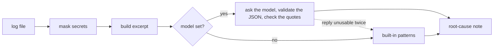

# LLM Failure-Log Explainer

When an Airflow task or a Spark job fails, the reason is usually in the log, somewhere under a few hundred
lines of routine output and a long stack trace. This tool reads the log, pulls out the part that matters,
masks secrets, and asks an LLM to write a short root-cause note in plain English: what failed, why it most
likely failed, which log lines show it, and what to try next.

It runs from the command line on any log file (gzipped EMR and YARN logs included) and as an Airflow
`on_failure_callback`. With no model configured it still writes a note, using a set of built-in failure
patterns.

## Example

```
$ explain-log samples/spark_executor_oom.log --no-llm
```

Output, with long lines wrapped:

```
## Failure note: Spark app trades_daily_aggregates

Application: `application_1760228400123_0412`

**What happened:** Spark app trades_daily_aggregates failed because a Spark executor ran out of memory.

**Likely root cause:** An executor used more memory than its container allows and was killed. When the same
task keeps failing on different executors while the others finish, one partition is usually far bigger than
the rest (data skew).

**Evidence from the log:**
26/10/12 02:31:44 ERROR YarnScheduler: Lost executor 7 on ip-10-0-3-21.ec2.internal: Container killed by YARN
for exceeding physical memory limits. 16.4 GB of 16 GB physical memory used. ...
py4j.protocol.Py4JJavaError: An error occurred while calling o212.parquet.

**What to try:**
1. Check the join and group-by keys of the failing stage for skew; split or salt the hot key, or turn on AQE
   skew-join handling (spark.sql.adaptive.enabled, spark.sql.adaptive.skewJoin.enabled).
2. Raise spark.sql.shuffle.partitions so each task handles less data.
3. If memory really is short, raise spark.executor.memoryOverhead or spark.executor.memory.

_Category: memory. Confidence: medium. Log: spark_executor_oom.log, 90 lines. Written by built-in rules (no LLM)._
```

That is the rule-based note. With a model, the note is written from this particular log, so it can use what
the rules can't: here, that task 112 died four times on four different executors while the other 199 tasks
finished in about 40 seconds each, and that the job was joining on `account_id`.

## How it works



1. **Read.** Plain text or `.gz`.
2. **Mask secrets.** Passwords in connection strings, AWS access keys, bearer tokens, `password=` / `token=` /
   `secret=` style values, email addresses, and long account-like numbers are masked before anything else
   sees the text.
3. **Build an excerpt.** Instead of the whole log, the model gets what a person would look at: the DAG, task,
   run, and try (or the Spark app and the failed stage), the known failure patterns that matched, the lines
   just before the first error, the error lines with repeats collapsed ("same message 4 times"), the exception
   and the deepest `Caused by`, a trimmed stack trace that keeps your own code's frames, any Spark settings,
   and the end of the log. It is capped at 12,000 characters by default.
4. **Explain.** The model is asked for JSON with a summary, the root cause (keeping what the log shows apart
   from what it infers), evidence lines copied from the excerpt, next steps, a category, and a confidence.
   The reply has to parse and fit the schema, with one retry if it doesn't. Any evidence line that isn't
   actually in the excerpt is dropped, so the note never quotes a log line that doesn't exist. If the model
   call fails, the rule-based note is used instead.
5. **Report.** Markdown for people, JSON for alerts and tickets.

## Quick start

```bash
python -m venv .venv && source .venv/bin/activate
pip install -e ".[anthropic]"        # or ".[openai]" / ".[bedrock]"
cp .env.example .env                 # set LLM_MODEL and your API key

explain-log samples/spark_executor_oom.log
explain-log samples/*.log --out notes/                            # one note per log
explain-log stderr.gz --format json                               # for alerts or tickets
explain-log samples/airflow_db_auth_failure.log --show-excerpt    # exactly what would be sent
explain-log samples/airflow_task_timeout.log --no-llm             # built-in patterns only
```

On Windows (PowerShell), set up the environment like this; the `explain-log` commands are the same, and the
tool expands wildcards like `samples/*.log` itself:

```powershell
python -m venv .venv
.\.venv\Scripts\Activate.ps1
pip install -e ".[anthropic]"
Copy-Item .env.example .env          # then set LLM_MODEL and your API key in .env
```

## In Airflow

```python
from log_explainer.airflow_callback import make_failure_callback

default_args = {"on_failure_callback": make_failure_callback()}
```

When a task fails, the callback finds the newest attempt log for that task in Airflow's default local log
layout (mapped tasks included), writes `attempt=N.rootcause.md` next to it, and passes the note to `on_note`
if you give it one, for example to post the summary to Slack:

```python
import requests


def post_to_slack(note, markdown):
    requests.post(SLACK_WEBHOOK_URL, json={"text": f"*{note.summary}*\n{note.root_cause}"}, timeout=10)


default_args = {"on_failure_callback": make_failure_callback(on_note=post_to_slack)}
```

The callback catches its own errors, so it can never hide the task's real failure. It needs this package on
the workers, and `LLM_MODEL` plus the provider's key in the worker environment; without them it falls back to
the built-in patterns. With remote logging (S3, CloudWatch), fetch the log text yourself and call
`explain_text()`. There is a full example in `examples/dag_with_explainer.py`.

## Using it from Python

```python
from log_explainer import explain_file, load_model
from log_explainer.report import to_markdown

llm, name = load_model("anthropic:claude-sonnet-5-5")
note, excerpt = explain_file("samples/spark_executor_oom.log", llm, name)
print(to_markdown(note, excerpt))
```

## Built-in failure patterns

`patterns.py` has signatures for: Spark executor and driver out-of-memory, lost shuffle data
(FetchFailedException), unresolved columns, tables, and paths (AnalysisException), broadcast timeouts,
Airflow task timeouts and sensor timeouts, processes killed from outside (zombies, SIGKILL), missing Python
packages, rejected credentials, access denied, unreachable hosts, Snowflake SQL errors, missing input files,
full disks, and failed data quality checks. Each one has an explanation and the usual fixes. Add your own
team's recurring failures there; they help both with and without a model.

## Configuration

| Setting | Default | Meaning |
|---|---|---|
| `LLM_MODEL` | none | Chat model as `provider:model`, passed to LangChain's `init_chat_model`. Without it, only the built-in patterns are used. |
| `AIRFLOW__LOGGING__BASE_LOG_FOLDER` | `$AIRFLOW_HOME/logs` | Where the callback looks for task logs |
| `--max-chars` | `12000` | Size cap for the excerpt sent to the model |

## Tests

```bash
pip install -e ".[dev]"
pytest
```

The tests use a scripted stand-in for the model, so they need no API key. They cover parsing of every
sample (metadata, exceptions, `Caused by` chains, repeat collapsing, gzip, the size cap), the patterns,
masking (including a check that secrets never reach the model), JSON validation and the retry, dropping
made-up evidence, falling back to the rules, the CLI, and the Airflow callback with a fake task instance.

## Sample logs

`samples/` has four made-up logs in the format Airflow 2.x and Spark 3.5 on YARN produce: a Snowflake MERGE
that runs past its `execution_timeout`, a Postgres password failure (with a password and an email address in
the log, to show the masking), an executor memory kill on one skewed task, and a PySpark
`AnalysisException` after an upstream column rename.

## Limitations

- The excerpt heuristics are tuned for Airflow and Spark. Other logs still get an excerpt, but less metadata
  and fewer pattern hits.
- The model only sees the excerpt, so a cause that shows up far from the error, such as in an upstream task's
  log, can be missed.
- Masking covers common secret formats, not every possible one. Use `--show-excerpt` to check what would be
  sent, and keep the notes somewhere with the same access as the logs.
- The callback reads local task logs only.


